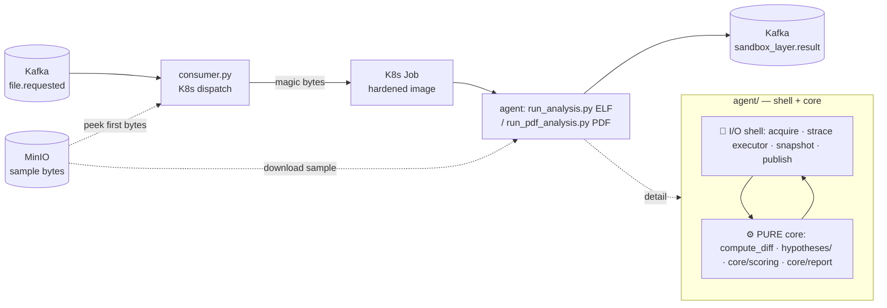

# Sandbox Layer — Architecture (the maintainer's map)

> Picking this code up in 6 months, or in 5 years? Read this page first. It gives
> you the full mental model in ~15 min. The `README.md` (next to it) explains how
> to **deploy/run**; this document explains how it's **built**.

## In one sentence

The sandbox layer receives a suspicious file (ELF or PDF) over Kafka, runs it in
isolation, observes its behaviour (syscalls, state diff, memory), scores 7
behavioural hypotheses, and publishes a **3-level report** to Kafka for the
aggregator, the LLM and the UI. Detection is **100% behavioural** — no
signatures, no external reputation.

## The pipeline at a glance



> **Two planes**: Kafka is the **control plane** (events `file.requested` →
> `sandbox_layer.result`); MinIO is the **data plane** (the sample bytes — the
> consumer peeks the first bytes for magic-byte routing, the agent downloads the
> full sample via presigned URL). **Redis is not used by this layer** — it's the
> aggregator/verdict layer's async result cache (out of scope here).

## Guiding principle: *Functional Core, Imperative Shell*

This is THE key to finding your way around. The code is split into two worlds:

- **Imperative shell** (I/O, side effects, **not testable in CI**): sample
  download, execution under `strace`, snapshot capture, `/proc` memory forensics,
  Kafka publishing, K8s Job creation.
- **Functional core** (pure, **golden-tested in CI**): `compute_diff`, the 7
  hypotheses (`hypotheses/`), scoring (`core/scoring.py`), report assembly
  (`core/report.py`).

**Why this matters for you**: if you're fixing a *logic* bug (score, verdict,
narrative, IOC), it lives in the **pure core** → write a golden test and it runs
in CI without a sandbox. If you touch **I/O** (strace, MinIO, Kafka), only a
**corpus run** on the VM validates it (image rebuild required).

## The two paths: ELF vs PDF

`consumer.py` routes by **magic bytes**: `\x7fELF` → `run_analysis.py`,
`%PDF`/unknown → `run_pdf_analysis.py`.

| | Shared (do not duplicate) | Path-specific |
|---|---|---|
| **Models** | `models/` (all) | — |
| **Hypotheses** | the 7 behavioural ones (`hypotheses/`) | PDF adds 5 static probes |
| **Scoring** | `core/scoring.compute_anomaly_score` | weight set (`DEFAULT_WEIGHTS` vs `PDF_WEIGHTS`) |
| **Report** | `core/report` (narrative, IOCs, event) | verdict thresholds, `_HYP_TO_MITRE`, `_ioc_type` |
| **Execution** | — | ELF: run the binary; PDF: `mutool` + `pdf_runner.js` |

Rule of thumb: anything **behavioural** is shared; only the **format-specific**
parts (how to execute, static probes, weight config) differ.

## File map

```
sandbox_layer/
├── consumer.py              # Shell: Kafka → create 1 K8s Job per sample (routes by magic bytes)
├── agent/                   # Runs INSIDE the K8s Job
│   ├── run_analysis.py      # ELF orchestrator (I/O shell + ELF config)
│   ├── run_pdf_analysis.py  # PDF orchestrator (I/O shell + PDF config)
│   ├── snapshot.py          # Shell: take_snapshot() ; compute_diff() is pure
│   ├── memory.py            # Shell: /proc forensics (RWX regions, strings)
│   ├── strace_collector.py  # Shell: parse strace logs → SyscallSummary
│   ├── probe_sample.py      # Type detection + PDF static probes (diagnostic harness)
│   ├── pdf_runner.js        # Runs the PDF's embedded JS (Node + stubbed PDF.js)
│   ├── core/                # ⚙️ PURE CORE (golden-tested)
│   │   ├── scoring.py        #   compute_anomaly_score(hyp, weights) + verdict_band()
│   │   └── report.py         #   build_pdf_narrative / build_elf_summary / build_iocs / build_result_event
│   ├── hypotheses/          # ⚙️ The 7 hypotheses (pure) + _types.py (contract) ; 5 PDF static probes
│   ├── models/              # Data contract (frozen Pydantic), re-exported via __init__
│   │   ├── snapshot.py       #   SnapshotState, SnapshotDiff + FS/proc/socket primitives
│   │   ├── signals.py        #   RuntimeSignals + syscalls/inotify/network
│   │   ├── memory.py         #   MemoryObservables + RWX regions
│   │   └── constants.py      #   volumetry caps + watched paths
│   └── tests/               # golden (pure core) + unit (hypotheses, pipeline)
│       ├── test_golden_core.py  #   pins scoring/verdict/narrative/IOC/event
│       └── golden/*.json        #   reference baseline (regenerable)
└── Dockerfile.{agent,pdf-agent,consumer}
```

## The 4-layer model

1. **Collection** (shell) — before/after snapshot, strace, `/proc` memory.
2. **Hypotheses** (`hypotheses/`, pure) — each module: `evaluate(diff, signals, memory) → HypothesisResult`. 7 behavioural (persistence, c2, injection, encryption, evasion, propagation, lolbins); PDF adds static probes aggregated into `pdf_static_indicators`.
3. **Scoring** (`core/scoring`, pure) — weighted sum → `anomaly_score` → verdict band (`malicious` ≥ 0.15; `needs_more_context` ≥ 0.04; otherwise `benign`). The sandbox is a **tie-breaker**: it escalates the ambiguous middle to the LLM.
4. **Report** (`core/report`, pure) — assembles `signals` (aggregator) + `features`/IOCs (LLM) + `narrative` (UI) into the Kafka event.

## Data flow (one analysis)

```
file.requested → consumer routes → K8s Job → run_*.py:
  1. acquire        (shell) download the sample from MinIO (presigned URL, SSRF-guard)
  2. [PDF] static   (shell) pdfid/qpdf/entropy → pdf_static_indicators
  3. snapshot BEFORE (shell)
  4. execute        (shell) strace -f <binary | mutool + pdf_runner.js>
  5. snapshot AFTER (shell) → compute_diff (PURE)
  6. collect        (shell) parse strace → RuntimeSignals ; /proc → MemoryObservables
  7. hypotheses     (PURE)  evaluate(diff, signals, memory) × 7 (+ PDF static)
  8. score          (PURE)  compute_anomaly_score → verdict_band
  9. report         (PURE)  build_iocs + build_result_event + narrative
 10. publish        (shell) → sandbox_layer.result
```

## How to extend

**Add a behavioural hypothesis**: create `hypotheses/my_rule.py` exposing
`evaluate(diff, signals, memory) → HypothesisResult` (pure, see `_types.py`).
Add its key + weight to `DEFAULT_WEIGHTS` (ELF) and/or `PDF_WEIGHTS` (PDF), and
to `_HYP_TO_MITRE`. Write a test (fixture → expected score).

**Add a file type** (e.g. DOCX): create `run_docx_analysis.py` (shell + config),
route it in `consumer.py` by magic bytes, reuse `core/` + `hypotheses/` as-is,
add your format-specific static probes.

**Re-tune the weights**: `DEFAULT_WEIGHTS`/`PDF_WEIGHTS` in the `run_*.py` files
(runtime override via `SANDBOX_WEIGHTS_JSON`). No logic to touch.

## The test net

- `tests/test_golden_core.py` — **golden / characterization**: pins the pure
  core's output (scoring, verdict, narrative, IOCs, event) on representative
  fixtures. Regenerate the baseline: `GOLDEN_UPDATE=1 pytest tests/test_golden_core.py`.
- `tests/test_pipeline_order.py`, `tests/test_lolbins.py` — unit tests on
  hypothesis orchestration and LOLBins detection.
- **Everything pure runs in CI** (`pytest tests/`). The I/O (shell) is validated
  by a **corpus run** on the VM (`make sandbox-validate`), after an image rebuild
  — because the agent runs from the image, not the source tree.

## Stack & constraints (do not break)

- K3s with **Calico as the sole CNI** (`calico-system`) — it provides both the pod dataplane and NetworkPolicy enforcement. K3s is installed with `--flannel-backend=none --disable-network-policy` (see `make install-k3s`), so flannel is **disabled**: without Calico the nodes are NotReady and, worse, NetworkPolicies are silently unenforced. Plus Bitnami Kafka (KRaft), MinIO StatefulSet, KEDA (scales on lag, max = number of `file.requested` partitions).
- Hardened `runc` container runtime (cap-drop ALL + `SYS_PTRACE` for strace, non-root UID 10001, seccomp, readOnlyRootFs); **gVisor enableable** via `SANDBOX_RUNTIME_CLASS=gvisor`.
- **Behavioural detection only** — no YARA/signatures/reputation. This is an architectural choice, not a gap.
- The ELF/Linux agent is the current scope; the Windows path (KVM) is planned but outside this code.
```
